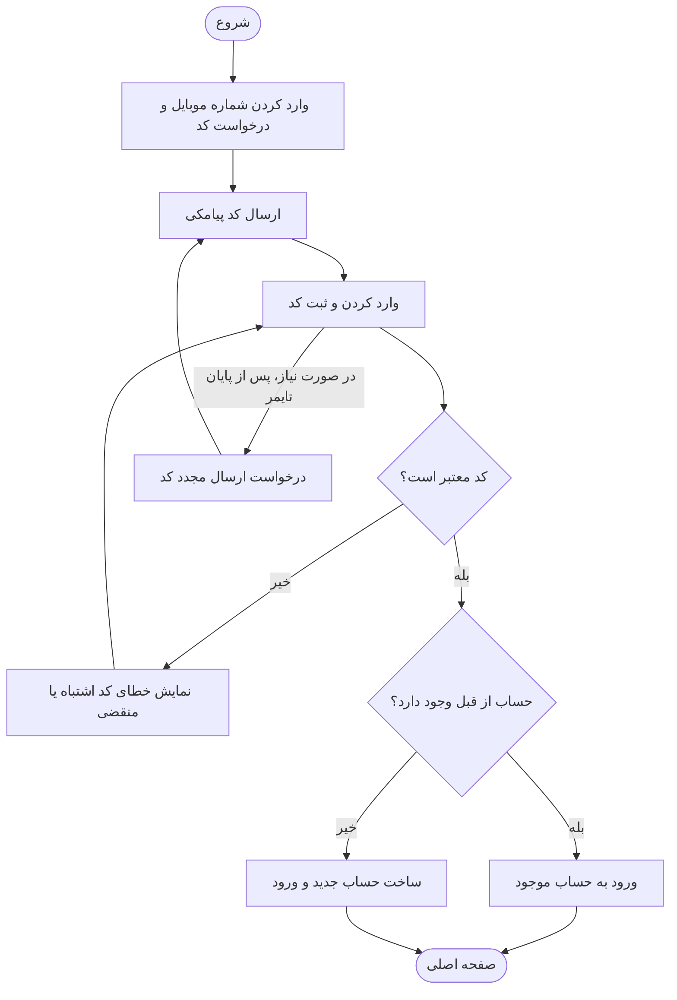

# مسیر ورود و ثبت‌نام با رمز یک‌بارمصرف

ورود و ثبت‌نام با دریافت یک کد پیامکی برای تأیید شماره موبایل آغاز می‌شوند. پس از تأیید کد، کاربر با حساب موجود وارد می‌شود یا برای او حساب جدید ساخته می‌شود.

## نمودار جریان

## مراحل

1. کاربر شماره موبایل خود را وارد می‌کند و درخواست دریافت کد می‌دهد.
2. سامانه رمز یک‌بارمصرف را به شماره واردشده پیامک می‌کند.
3. کاربر کد را وارد می‌کند و آن را برای بررسی می‌فرستد.
4. اگر کد اشتباه یا منقضی باشد، سامانه پیام خطا نشان می‌دهد و کاربر به مرحله ورود کد برمی‌گردد. در صورت نیاز، کاربر پس از پایان تایمر می‌تواند درخواست کد جدید بدهد.
5. اگر کد معتبر باشد، سامانه بررسی می‌کند که آیا برای این شماره حسابی وجود دارد. کاربر با حساب موجود وارد می‌شود. اگر حسابی وجود نداشته باشد، سامانه حساب جدید می‌سازد و کاربر را وارد می‌کند.
6. کاربر به صفحه اصلی هدایت می‌شود.

[تصویر فلوچارت](../otp-user-flow.png)
